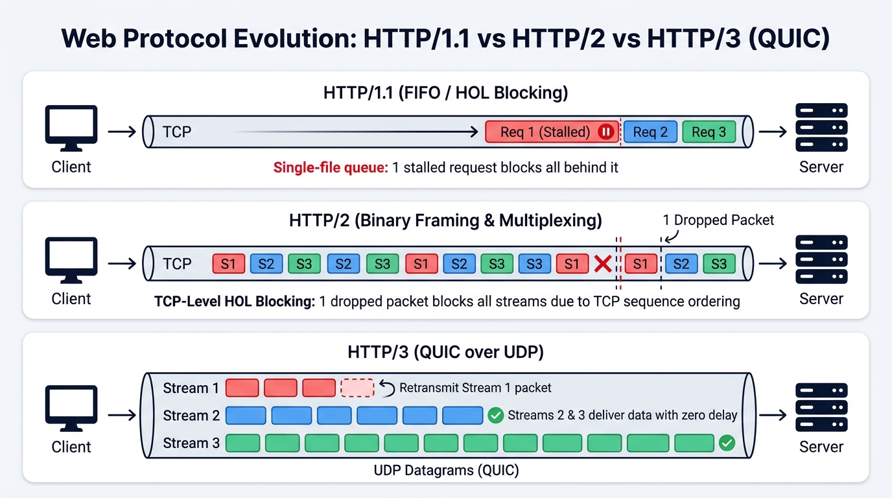

# ⚡ 02: Protocol Evolution — HTTP/1.1 vs HTTP/2 vs HTTP/3 (QUIC)

> *"The story of web protocol evolution is the story of human engineers continuously hitting physical network bottlenecks, discovering that their abstractions were leaking, and rewriting the stack from first principles."*

---

## 🧭 The First-Principles Problem

In 1991, Tim Berners-Lee designed **HTTP/0.9** for a simple world: a client sent `GET /index.html`, the server replied with raw ASCII text, and immediately severed the TCP connection.

Today, loading a modern web page or mobile app requires transferring **over 150 independent sub-resources**:
- 30 JavaScript bundles and modules
- 20 CSS stylesheets
- 60 image assets, SVGs, and web fonts
- Dozens of dynamic asynchronous JSON/gRPC API requests

If you try to push 150 separate resources through the original 1990s protocols across real-world physical fiber cables and lossy wireless networks, the system collapses under its own latency overhead.

To solve this, the engineering community went through **three evolutionary revolutions**, each discovering and conquering a deeper layer of **Head-of-Line (HOL) Blocking**.

---

## 🪜 The Evolutionary Timeline: Summary of Breakthroughs



```
1996: HTTP/1.0 ────> Connection Churn (1 TCP handshake per file)
        │
        ▼
1999: HTTP/1.1 ────> Persistent Keep-Alive & Application Head-of-Line (HOL) Blocking
        │
        ▼
2015: HTTP/2   ────> Binary Framing, Stream Multiplexing & TCP Head-of-Line Blocking
        │
        ▼
2022: HTTP/3   ────> QUIC over UDP, Independent Streams & 0-RTT Connection Migration
```

---

## 🔬 Deep Dive: Stage by Stage

### 1. HTTP/1.0 & The Connection Churn Nightmare

In HTTP/1.0, every single resource request required its own dedicated TCP connection:

```
Client                                                   Server
  │─── SYN ──────────────────────────────────────────────>│ (TCP Handshake)
  │<── SYN-ACK ───────────────────────────────────────────│
  │─── ACK + GET /logo.png ──────────────────────────────>│
  │<── 200 OK [Image Data] ───────────────────────────────│
  │─── FIN / CLOSE ───────────────────────────────────────>│ (Connection destroyed!)
  │
  │─── SYN ──────────────────────────────────────────────>│ (Brand new handshake for style.css!)
  │<── SYN-ACK ───────────────────────────────────────────│
  │─── ACK + GET /style.css ─────────────────────────────>│
  │<── 200 OK [CSS Data] ─────────────────────────────────│
  │─── FIN / CLOSE ───────────────────────────────────────>│
```

#### Why This Failed Physically:
1. **Handshake Overhead**: Fetching 100 files meant paying **100 separate 1-RTT connection setup costs** ($100 \times 80\text{ms} = 8\text{ seconds}$ wasted purely on handshakes).
2. **TCP Slow-Start Penalty**: Every new TCP connection starts with a tiny congestion window (typically 10 packets) to probe network capacity. Discarding the connection after each file meant web pages were perpetually trapped in the slowest phase of TCP!

---

### 2. HTTP/1.1: Persistent Connections & Application HOL Blocking

RFC 2616 (1999) solved connection churn by introducing **`Connection: keep-alive`**:
- Once a TCP connection is established, it stays open.
- The client can reuse the exact same connection to request `/logo.png`, then `/style.css`, then `/app.js`.

HTTP/1.1 also attempted **Pipelining**: allowing the client to send Request 2 before waiting for Response 1.

#### The Fatal Flaw: Application-Layer Head-of-Line (HOL) Blocking
HTTP/1.1 has no concept of stream IDs or message tags. Responses are delivered as a raw stream of bytes down the TCP socket. 

Because the client has no way to tell which byte belongs to which file, **the server is strictly forced to send responses in the exact order requests were received**:

```
Client                                                  Server
  │─── Request 1: GET /heavy-report.pdf (takes 3000ms) ──>│
  │─── Request 2: GET /avatar.png       (takes 5ms) ─────>│
  │─── Request 3: GET /style.css        (takes 2ms) ─────>│
  │                                                       │
  │    [Request 2 & 3 finished in memory in 5ms,          │
  │     but MUST WAIT 3000ms behind Request 1!]           │
  │                                                       │
  │<── 200 OK [heavy-report.pdf] ─────────────────────────│ (3000ms elapsed)
  │<── 200 OK [avatar.png] ───────────────────────────────│
  │<── 200 OK [style.css] ────────────────────────────────│
```

If Request 1 hits a slow database query or hangs, **all subsequent responses behind it are completely blocked**.

#### The Hacks Engineers Built to Survive HTTP/1.1:
To mitigate this architectural flaw, the industry invented complex workarounds:
- **Browser Multi-Connection Limit**: Browsers opened 6 parallel TCP connections per domain.
- **Domain Sharding**: Serving assets from `static1.example.com`, `static2.example.com`, `static3.example.com` to trick browsers into opening 18–24 concurrent TCP sockets.
- **Image Sprites**: Stitching 50 small icons into one massive image to reduce request count.
- **File Concatenation & Bundling**: Merging 40 JavaScript files into one giant bundle, breaking browser caching.

---

### 3. HTTP/2: Binary Framing & Multiplexing

Standardized in 2015 (RFC 7540, derived from Google's SPDY), **HTTP/2 completely eliminated Application-Layer HOL Blocking**.

#### Core Innovation 1: The Binary Framing Layer
Instead of plain ASCII text lines separated by carriage returns (`\r\n`), HTTP/2 divides all communication into structured **binary frames**:

```
┌─────────────────────────────────────────────────────────────┐
│ Length (24 bits) │ Type (8 bits) │ Flags (8 bits)           │
├─────────────────────────────────────────────────────────────┤
│ R (1 bit) │ Stream Identifier (31 bits)                     │
├─────────────────────────────────────────────────────────────┤
│ Frame Payload (Variable Length)                             │
└─────────────────────────────────────────────────────────────┘
```

- **Headers Frame**: Contains HTTP headers compressed with HPACK.
- **Data Frame**: Contains the actual payload payload bytes.
- **Stream ID**: A 31-bit integer identifying which logical request/response this frame belongs to.

#### Core Innovation 2: Stream Multiplexing over 1 TCP Connection
Because every frame is tagged with a `Stream Identifier`, client and server can **interleave frames from dozens of requests simultaneously down a single TCP connection**:

```
[TCP Stream]: [Frame Stream 1] [Frame Stream 3] [Frame Stream 1] [Frame Stream 2] [Frame Stream 3] ...
```

The receiver simply reads the Stream ID and reassembles the independent resources in memory. **A slow request on Stream 1 no longer delays Stream 2 or Stream 3!**

#### Core Innovation 3: HPACK Header Compression
In HTTP/1.1, every request repeated identical headers (Cookie, User-Agent, Accept) averaging 500–1500 bytes of overhead. 
HPACK maintains a synchronized **static table** (61 common header fields) and **dynamic table** between client and server, compressing headers by up to **85–90%**.

---

### 4. The Fatal Flaw of HTTP/2: TCP-Layer Head-of-Line Blocking

HTTP/2 was hailed as a triumph—until real-world mobile networks revealed a severe flaw.

HTTP/2 runs on top of standard **TCP**. 
TCP is fundamentally a **single, contiguous byte stream abstraction**. It guarantees:
1. Every byte arrives.
2. Every byte is delivered to the operating system in strict sequential order.

#### What happens when a single packet is lost?
Imagine an HTTP/2 connection carrying Stream 1 (image), Stream 2 (CSS), and Stream 3 (JavaScript).
Packets are traveling across a lossy 4G cell tower. **One single packet belonging to Stream 1 is dropped**:

```
Packets Arriving at Client Kernel:
[Pkt 1: Stream 1]  ✅ Received
[Pkt 2: Stream 1]  ❌ DROPPED BY CELL TOWER!
[Pkt 3: Stream 2]  ✅ Received
[Pkt 4: Stream 3]  ✅ Received
[Pkt 5: Stream 2]  ✅ Received
```

Even though the packets for Stream 2 (CSS) and Stream 3 (JS) arrived completely intact, **the OS TCP stack refuses to release them to the browser** until Packet 2 is retransmitted!

> ⚠️ **The Paradox**: Under 2% packet loss on mobile networks, **HTTP/2 often performs worse than HTTP/1.1**! In HTTP/1.1 with 6 separate TCP connections, a dropped packet on connection 1 only froze that single connection; the other 5 kept downloading. In HTTP/2, all streams share one TCP pipe, so **one dropped packet freezes the entire web application**!

---

### 5. HTTP/3 & QUIC: Re-architecting over UDP

Engineers asked: *"Can we fix TCP to support multi-stream packet recovery?"*
The answer was **No**, due to **Protocol Ossification**: millions of enterprise routers, middleboxes, and NAT firewalls across the globe inspect TCP headers. If you change how TCP flags work, existing hardware drops the packets as corrupt.

Google's solution was audacious: **Discard TCP entirely and build a new transport protocol (QUIC) on top of UDP** (standardized as HTTP/3 in 2022 via RFC 9000 & RFC 9114).

```
  Traditional Stack (HTTP/2)             Modern Stack (HTTP/3)
┌────────────────────────────┐        ┌────────────────────────────┐
│          HTTP/2            │        │          HTTP/3            │
├────────────────────────────┤        ├────────────────────────────┤
│          TLS 1.3           │        │            QUIC            │
├────────────────────────────┤        │ (Streams, Flow Control,    │
│           TCP              │        │  Integrated TLS 1.3)       │
├────────────────────────────┤        ├────────────────────────────┤
│            IP              │        │            UDP             │
└────────────────────────────┘        ├────────────────────────────┤
                                      │            IP              │
                                      └────────────────────────────┘
```

#### Why UDP?
UDP is an unopinionated, bare-bones packet envelope. It does not enforce ordering, retransmissions, or handshakes. This allowed the QUIC designers to implement **stream-aware reliability completely in user space**.

#### Breakthrough 1: Truly Independent Streams (No TCP HOL Blocking)
In QUIC, the transport layer natively understands individual streams.
- If a packet belonging to **Stream 1** is dropped, QUIC retransmits that packet.
- Meanwhile, packets for **Stream 2** and **Stream 3** are delivered to the application **immediately without waiting**!

#### Breakthrough 2: 0-RTT Connection Establishment
QUIC merges the transport handshake and the cryptographic handshake into one single interaction.
- **First-time connection**: 1 RTT (Transport parameters + TLS 1.3 keys exchanged together).
- **Subsequent connections (Reconnection)**: **0-RTT**! The client can send encrypted application data on the very first packet using cached session tokens!

#### Breakthrough 3: Connection Migration (Seamless Mobile Roaming)
A traditional TCP connection is permanently bound to a 4-tuple:
$$\text{Connection} = (\text{Client IP}, \text{Client Port}, \text{Server IP}, \text{Server Port})$$

When you leave your house and your smartphone switches from **Home Wi-Fi** to **Cellular 5G**, your phone gets a new IP address. 
- Under TCP (HTTP/1.1 and HTTP/2), the connection instantly breaks. All downloads abort, video buffers freeze, and full handshakes must restart.
- **QUIC solves this using a 64-bit Connection ID (CID)**: The connection identity is carried inside the QUIC header, independent of the network interface. When your phone transitions from Wi-Fi to 5G, it keeps using the same CID. The server seamlessly continues streaming data without any interruption!

---

## 📊 Comprehensive Architectural Comparison Matrix

| Architectural Feature | HTTP/1.1 (1999) | HTTP/2 (2015) | HTTP/3 (QUIC) (2022) |
|---|---|---|---|
| **Underlying Transport** | TCP | TCP | **UDP (via QUIC)** |
| **Data Format** | Plain ASCII Text | Binary Framing | Binary Framing |
| **Multiplexing** | ❌ No (Serialized FIFO) | ✅ Yes (Multiplexed Streams) | ✅ Yes (Native Independent Streams) |
| **Application HOL Blocking** | ❌ High (Stalled responses block pipe) | ✅ Solved via Stream IDs | ✅ Solved |
| **TCP HOL Blocking** | ⚪ Partial (Isolated across 6 sockets) | ❌ Critical (1 lost packet freezes all) | ✅ **Eliminated completely** |
| **Header Compression** | ❌ None (Redundant plaintext) | ✅ HPACK (Static + Dynamic table) | ✅ **QPACK** (Out-of-order decompression) |
| **Handshake Latency** | 2–3 RTT (TCP + TLS separate) | 2 RTT (1 TCP + 1 TLS 1.3) | **0–1 RTT** (Combined QUIC handshake) |
| **Mobile IP Migration** | ❌ Connection drops on Wi-Fi $\rightarrow$ 5G | ❌ Connection drops | ✅ **Seamless (Connection ID)** |
| **Encryption** | Optional (HTTPS via TLS) | In practice mandatory (`h2`) | **Strictly Mandatory** (TLS 1.3 built-in) |

---

## 🎯 System Design Interview Takeaways

1. **"When would you choose HTTP/2 over HTTP/3 in production?"**
   - *Answer*: HTTP/3 requires UDP traffic to pass through corporate firewalls, proxies, and cloud load balancers. Many legacy enterprise networks block UDP on non-standard ports or throttle UDP as potential DDoS traffic. Production edge architectures typically use **HTTP/3 as default with automatic fallback to HTTP/2** via the `Alt-Svc` (Alternative Services) HTTP header.
2. **"Why can't we use HPACK in HTTP/3?"**
   - *Answer*: HPACK relies on in-order frame delivery to keep dynamic compression tables in sync between client and server. Because QUIC delivers streams out-of-order over UDP, an out-of-order header frame would corrupt the HPACK dynamic table! Therefore, HTTP/3 invented **QPACK**, which uses dedicated unidirectional control streams to synchronize dictionary updates independently.
3. **"How does HTTP/2 Server Push work, and why was it deprecated in Chrome?"**
   - *Answer*: Server Push allowed servers to send CSS/JS files before the client asked for them. In practice, servers frequently pushed files that clients already had cached locally, wasting bandwidth and battery life. It was replaced by the `103 Early Hints` status code.
